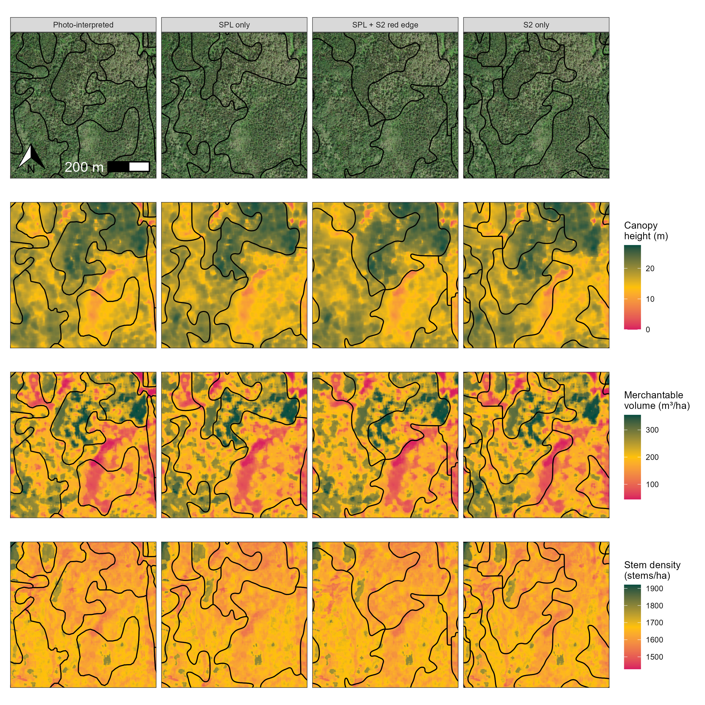
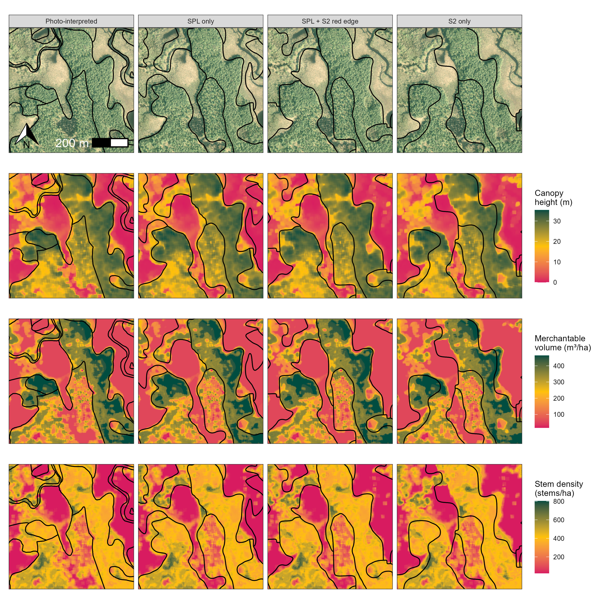
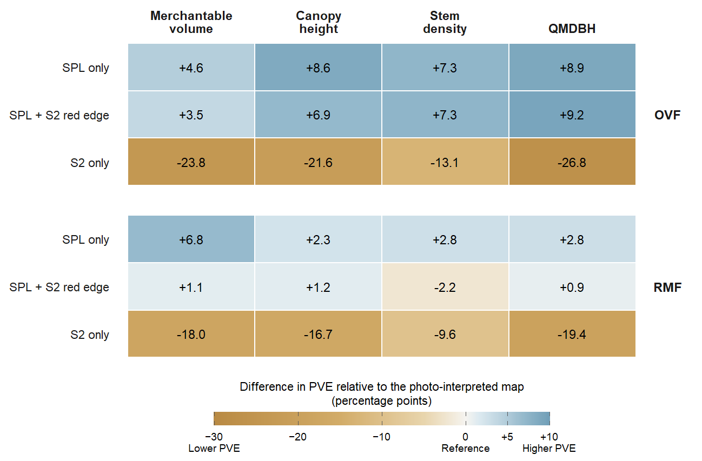
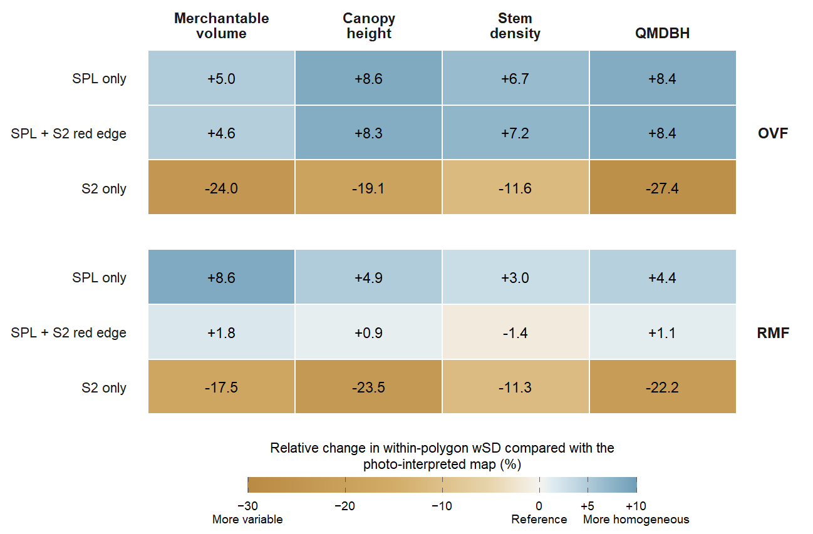
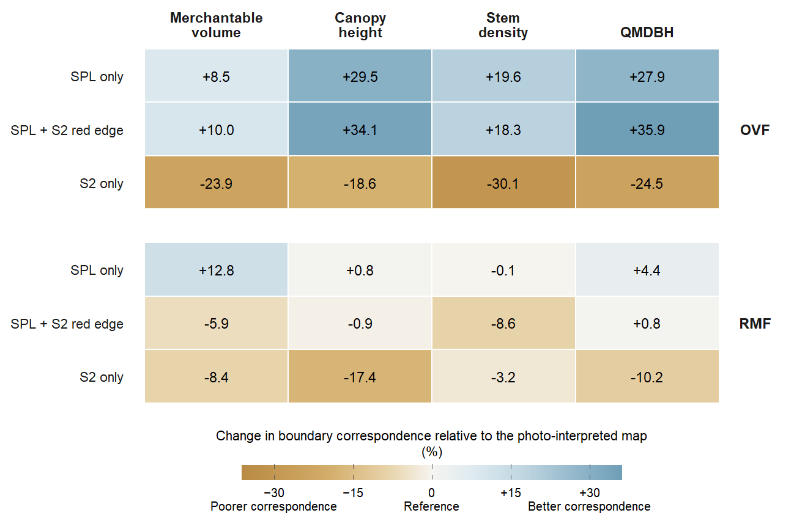

```{r}
#| label: setup
#| include: false

knitr::opts_chunk$set(echo = TRUE)

```

```{r}
#| label: read-library
#| echo: false
#| results: hide
#| message: false
#| warning: false
library(tidyverse)
library(magrittr)
library(terra)
library(tidyterra)
library(sf)
library(smoothr)
library(exactextractr)
library(rmapshaper)
library(nngeo)
library(sf)
library(leaflet)
# pak::pak("metafor-ulaval/eFRItools")
library(eFRItools)
library(knitr)
library(maptiles)
library(patchwork)
library(reticulate)
```

```{r}
#| label: parameters
#| echo: false
#| results: hide
#| message: false
#| warning: false
Sys.setenv(OTB_MAX_RAM_HINT = "65536") # 64 GO
Sys.setenv(OTB_MEMORY_AVAILABLE = "65536") # 64 GO
Sys.setenv(GDAL_CACHEMAX = "65536") # 64 GO
otb_dir <- "D:/00_Ontario_eFRI/10_livrables/app/softwares/OTB-9.1.0-Win64/bin"

use_python("C:/Program Files/ArcGIS/Pro/bin/Python/envs/arcgispro-py3/python.exe", required = TRUE)
arcpy <- import("arcpy")

wd <- "D:/00_Ontario_eFRI/10_livrables" # wd
summary_metrics <- c("vmerch_ha", "qmdbh", "dens", "ba_ha", "z_p95", "z_above2", "slope", "sagawi")

forests <- c("RMF", "OVF")
models <- list(model_B = c("z_p95", "z_above2", "z_skew"),
               model_F = c("z_p95", "z_above2", "B6"),
               model_G = c("B6", "B8", "B11"))

params <- expand.grid(forests = forests,
                      models = models,
                      stringsAsFactors = FALSE)
```

```{r}
#| label: read-data
#| include: false
#| message: false
#| warning: false
# RMF
# Parameters
param_figures_rmf <- params[1,]
segmentation_metrics <- param_figures_rmf$models[[1]]

segmentation_wd_rmf <- paste0(wd, "/segmentation/", param_figures_rmf$forest, "/", names(param_figures_rmf$models))

list.files(paste0(wd, "/analysis/imputation"), pattern = paste0("results_", param_figures_rmf$forest), full.names = T) %>% 
  map_dfr(function(x){
    read.csv(x) %>%
      arrange(desc(accuracy)) %>%
      slice_max(accuracy, n = 1)
  }) -> imputation_results

# Metrics infos
list.files(paste0(wd, "/metrics/", param_figures_rmf$forest), full.names = TRUE) %>%
  read_metrics() -> metrics_infos_rmf

# EPSG
metrics_infos_rmf %>% 
  filter(name == "dem") %>% 
  pull(path) %>% 
  rast() -> epsg_rast_rmf

epsg_rast_rmf %>% 
  st_crs() -> epsg_rmf

# FMU
st_read(paste0(wd, "/shapefiles/FORMGMT/FOREST_MANAGEMENT_UNIT.shp"), quiet = T) %>% 
  filter(FMU_NAME == "Romeo Malette Forest") %>% 
  st_transform(epsg_rmf) -> rmf

# Areas
rmf %>% 
  st_geometry() %>%
  st_transform(4326) %>% 
  st_as_sf() -> rmf_4326

rmf %>%
  st_bbox() %>%
  st_as_sfc() %>%
  st_centroid() %>%
  st_buffer(2500) %>%
  st_bbox() %>%
  st_as_sfc() %>% 
  st_as_sf() -> subset_area_rmf

subset_area_rmf %>% 
  st_transform(4326) %>% 
  st_as_sf() -> subset_area_rmf_4326

# Imagery
sat_rmf <- get_tiles(x = st_bbox(rmf_4326 %>% st_buffer(5000)),
                     provider = "Esri.WorldImagery",
                     zoom = 11,
                     crop = TRUE)

sat_subset_area_rmf <- get_tiles(x = st_bbox(subset_area_rmf_4326 %>% st_buffer(100)),
                                 provider = "Esri.WorldImagery",
                                 zoom = 15,
                                 crop = TRUE)

# Read metrics
metrics_infos_rmf %>%
  filter(name %in% segmentation_metrics) -> metrics_infos_selected_rmf
  
metrics_infos_selected_rmf %>%
  pull(name) -> metrics_names
  
metrics_infos_selected_rmf %>%
  pull(path) %>%
  map(rast) %>%
  map(project, epsg_rast_rmf, method = "bilinear") %>%
  map(resample, epsg_rast_rmf) %>%
  rast() %>% 
  crop(subset_area_rmf) -> metrics_rmf
  
names(metrics_rmf) <- metrics_names # Assign metrics names

# Masks
list(vect(paste0(wd, "/shapefiles/", param_figures_rmf$forest, "/roads.shp")),
     vect(paste0(wd, "/shapefiles/", param_figures_rmf$forest, "/waterbodies.shp"))) %>%
  map(project, epsg_rast_rmf) %>% 
  map(crop, subset_area_rmf) %>% 
  map(project, subset_area_rmf_4326) -> masks_rmf_4326

# Segmentation
st_read(paste0(segmentation_wd_rmf, "/data.gpkg"), 
         layer = paste0(names(param_figures_rmf$models), "_data_imputation_clipped"), # Clipped on ArcGIS
         quiet = T) %>% 
  st_cast("POLYGON") %>%
  st_transform(epsg_rmf) -> segmentation_rmf

segmentation_rmf %>% 
  st_filter(subset_area_rmf) %>% 
  ms_clip(subset_area_rmf) %>% 
  st_transform(4326) -> segmentation_rmf_clip_4326

# Segmentation smoothed
st_read(paste0(segmentation_wd_rmf, "/data.gpkg"), 
         layer = paste0(names(param_figures_rmf$models), "_data_imputation_smoothed_clipped"), # Clipped on ArcGIS
         quiet = T) %>% 
  st_cast("POLYGON") %>%
  st_transform(epsg_rmf) -> segmentation_smoothed_rmf

segmentation_smoothed_rmf  %>% 
  st_filter(subset_area_rmf) %>% 
  ms_clip(subset_area_rmf) %>% 
  st_transform(4326) -> segmentation_smoothed_rmf_clip_4326

# Segmentation with masks smoothed
st_read(paste0(segmentation_wd_rmf, "/data.gpkg"), 
         layer = paste0(names(param_figures_rmf$models), "_masks_smoothed_clipped"), # Clipped on ArcGIS
         quiet = T) %>% 
  st_cast("POLYGON") %>%
  st_transform(epsg_rmf) -> segmentation_masks_smoothed_rmf

segmentation_masks_smoothed_rmf  %>% 
  st_filter(subset_area_rmf) %>% 
  ms_clip(subset_area_rmf) %>% 
  st_transform(4326) -> segmentation_masks_smoothed_rmf_clip_4326

# Photo-interpreted polygons
st_read(paste0(wd, "/shapefiles/", param_figures_rmf$forest, "/PolygonForest.shp"), 
        quiet = T) %>% 
  st_cast("POLYGON") %>% 
  rowid_to_column("id") %>%
  st_transform(epsg_rmf) -> fri_polygons_rmf

fri_polygons_rmf %>% 
  st_filter(subset_area_rmf) %>% 
  ms_clip(subset_area_rmf) %>% 
  st_transform(4326) -> fri_polygons_rmf_clip_4326


# OVF
# Parameters
param_figures_ovf <- params[2,]
segmentation_metrics <- param_figures_ovf$models[[1]]

segmentation_wd_ovf <- paste0(wd, "/segmentation/", param_figures_ovf$forest, "/", names(param_figures_ovf$models))

# Metrics infos
list.files(paste0(wd, "/metrics/", param_figures_ovf$forest), full.names = TRUE) %>%
  read_metrics() -> metrics_infos_ovf

# EPSG
metrics_infos_ovf %>% 
  filter(name == "dem") %>% 
  pull(path) %>% 
  rast() -> epsg_rast_ovf

epsg_rast_ovf %>% 
  st_crs() -> epsg_ovf

# FMU
st_read(paste0(wd, "/shapefiles/FORMGMT/FOREST_MANAGEMENT_UNIT.shp"), quiet = T) %>% 
  filter(FMU_NAME == "Ottawa Valley Forest") %>% 
  st_transform(epsg_ovf) -> ovf

# Areas
ovf %>% 
  st_geometry() %>%
  st_transform(4326) %>% 
  st_as_sf() -> ovf_4326

ovf %>%
  st_bbox() %>%
  st_as_sfc() %>%
  st_centroid() %>%
  st_buffer(2500) %>%
  st_bbox() %>%
  st_as_sfc() %>% 
  st_as_sf() -> subset_area_ovf

subset_area_ovf %>% 
  st_transform(4326) %>% 
  st_as_sf() -> subset_area_ovf_4326

# Imagery
sat_ovf <- get_tiles(x = st_bbox(ovf_4326 %>% st_buffer(5000)),
                     provider = "Esri.WorldImagery",
                     zoom = 11,
                     crop = TRUE)

sat_subset_area_ovf <- get_tiles(x = st_bbox(subset_area_ovf_4326 %>% st_buffer(100)),
                                 provider = "Esri.WorldImagery",
                                 zoom = 15,
                                 crop = TRUE)

# Segmentation
st_read(paste0(segmentation_wd_ovf, "/data.gpkg"), 
         layer = paste0(names(param_figures_ovf$models), "_data_imputation"), # Clipped on ArcGIS
         quiet = T) %>% 
  st_cast("POLYGON") %>%
  st_transform(epsg_ovf) -> segmentation_ovf

segmentation_ovf %>% 
  st_filter(subset_area_ovf) %>% 
  ms_clip(subset_area_ovf) %>% 
  st_transform(4326) -> segmentation_ovf_clip_4326

# Segmentation smoothed
st_read(paste0(segmentation_wd_ovf, "/data.gpkg"), 
         layer = paste0(names(param_figures_ovf$models), "_data_imputation_smoothed"), # Clipped on ArcGIS
         quiet = T) %>% 
  st_cast("POLYGON") %>%
  st_transform(epsg_ovf) -> segmentation_smoothed_ovf

segmentation_smoothed_ovf  %>% 
  st_filter(subset_area_ovf) %>% 
  ms_clip(subset_area_ovf) %>% 
  st_transform(4326) -> segmentation_smoothed_ovf_clip_4326

# Photo-interpreted polygons
st_read(paste0(wd, "/shapefiles/", param_figures_ovf$forest, "/PolygonForest.shp"), 
        quiet = T) %>% 
  st_cast("POLYGON") %>%
  rowid_to_column("id")  %>% 
  st_transform(epsg_ovf) -> fri_polygons_ovf

fri_polygons_ovf %>% 
  st_filter(subset_area_ovf) %>% 
  ms_clip(subset_area_ovf) %>% 
  st_transform(4326) -> fri_polygons_ovf_clip_4326
```

# **1** Automated stand delineations {-#segmentation-results}

This section and the next present the final products, produced with the "SPL only" scenario (see [Data and Methods](data_and_method.qmd#Segmentation-generation)). Maps show a 5 × 5 km subset of each FMU (red square in @fig-study-area-subset-rmf and @fig-study-area-subset-ovf), while statistics cover the entire FMU (yellow outline).

```{r}
#| label: fig-study-area-subset-rmf
#| echo: false
#| results: hide
#| message: false
#| warning: false
#| fig-cap: "Romeo Malette Forest (yellow outline) and the 5 × 5 km subset used for maps (red square)."
ggplot() +
  geom_spatraster_rgb(data = sat_rmf*1.5) +
  geom_sf(data = rmf_4326, color = "#FEFE62", fill = NA, lwd = 1) +
  geom_sf(data = subset_area_rmf_4326, color = "red", fill = NA, lwd = 1) +
  scale_x_continuous(expand = c(0, 0)) +
  scale_y_continuous(expand = c(0, 0)) +
  theme_bw()
```

```{r}
#| label: fig-study-area-subset-ovf
#| echo: false
#| results: hide
#| message: false
#| warning: false
#| fig-cap: "Ottawa Valley Forest (yellow outline) and the 5 × 5 km subset used for maps (red square)."
ggplot() +
  geom_spatraster_rgb(data = sat_ovf*1.5) +
  geom_sf(data = ovf_4326, color = "#FEFE62", fill = NA, lwd = 1) +
  geom_sf(data = subset_area_ovf_4326, color = "red", fill = NA, lwd = 1) +
  scale_x_continuous(expand = c(0, 0)) +
  scale_y_continuous(expand = c(0, 0)) +
  theme_bw()
```

## **1.1** Delineations at the FMU scale {-#segmentation-results-fmu}

@fig-segmentation-exemple-rmf and @fig-fri-exemple-rmf compare the automated and FRI polygons in the RMF subset.

```{r}
#| label: fig-segmentation-exemple-rmf
#| echo: false
#| results: hide
#| message: false
#| warning: false
#| fig-cap: "Smoothed automated stand delineation (SPL only) in the Romeo Malette Forest subset."
ggplot() +
  geom_spatraster_rgb(data = sat_subset_area_rmf*1.5) +
  geom_sf(data = segmentation_smoothed_rmf_clip_4326, 
          color = "#FFC107", alpha = 0, size = 0.5) +
  geom_sf(data = subset_area_rmf_4326, color = "red", fill = NA, lwd = 1) +
  scale_x_continuous(expand = c(0, 0)) +
  scale_y_continuous(expand = c(0, 0)) +
  theme_bw()
```

```{r}
#| label: fig-fri-exemple-rmf
#| echo: false
#| results: hide
#| message: false
#| warning: false
#| fig-cap: "FRI polygons in the Romeo Malette Forest subset."
ggplot() +
  geom_spatraster_rgb(data = sat_subset_area_rmf*1.5) +
  geom_sf(data = fri_polygons_rmf_clip_4326, 
          color = "#1E88E5", alpha = 0, size = 0.5) + 
  geom_sf(data = subset_area_rmf_4326, color = "red", fill = NA, lwd = 1) +
  scale_x_continuous(expand = c(0, 0)) +
  scale_y_continuous(expand = c(0, 0)) +
  theme_bw()
```

@fig-segmentation-exemple-ovf and @fig-fri-exemple-ovf show the same comparison for OVF.

```{r}
#| label: fig-segmentation-exemple-ovf
#| echo: false
#| results: hide
#| message: false
#| warning: false
#| fig-cap: "Smoothed automated stand delineation (SPL only) in the Ottawa Valley Forest subset."
ggplot() +
  geom_spatraster_rgb(data = sat_subset_area_ovf/1.2) +
  geom_sf(data = segmentation_smoothed_ovf_clip_4326, 
          color = "#FFC107", alpha = 0, size = 0.5) +
  geom_sf(data = subset_area_ovf_4326, color = "red", fill = NA, lwd = 1) +
  scale_x_continuous(expand = c(0, 0)) +
  scale_y_continuous(expand = c(0, 0)) +
  theme_bw()
```

```{r}
#| label: fig-fri-exemple-ovf
#| echo: false
#| results: hide
#| message: false
#| warning: false
#| fig-cap: "FRI polygons in the Ottawa Valley Forest subset."
ggplot() +
  geom_spatraster_rgb(data = sat_subset_area_ovf/1.2) +
  geom_sf(data = fri_polygons_ovf_clip_4326, 
          color = "#1E88E5", alpha = 0, size = 0.5) + 
  geom_sf(data = subset_area_ovf_4326, color = "red", fill = NA, lwd = 1) +
  scale_x_continuous(expand = c(0, 0)) +
  scale_y_continuous(expand = c(0, 0)) +
  theme_bw()
```

Over the whole RMF, the segmentation produced `r format(nrow(segmentation_smoothed_rmf), big.mark = ",")` polygons, compared with `r format(nrow(fri_polygons_rmf), big.mark = ",")` FRI polygons. In OVF, it produced `r format(nrow(segmentation_smoothed_ovf), big.mark = ",")` polygons, compared with `r format(nrow(fri_polygons_ovf), big.mark = ",")` FRI polygons. **[TO COMPLETE: one sentence explaining the larger difference in OVF.]**

Because segmentation parameters were calibrated on FRI polygons (see [Appendix A](segmentation_parameters_optimisation.qmd)), automated polygons are expected to have size and shape distributions close to those of FRI polygons. @fig-density-area-rmf to @fig-density-shape-ovf compare these distributions in each FMU. Size is expressed as polygon area (ha), and shape by the shape index:

$$
ShapeIndex = \frac{\text{Perimeter}}{\sqrt{\pi \times \text{Area}}}
$$

which equals 2 for a circle and increases as polygons become more elongated or irregular. Distributions are computed at the pixel level, so that each polygon is weighted by its area.

**[TO COMPLETE: one or two sentences summarizing the comparison, e.g. overlap (%) between the area and shape distributions of automated and FRI polygons in each FMU.]**

```{r}
#| label: density-rmf
#| echo: false
#| results: hide
#| message: false
#| warning: false
metrics_infos_rmf %>% 
  filter(name == "dem") %>% 
  pull(path) %>% 
  rast() -> metric_ref

# Compute performance metrics
fri_polygons_rmf %>% 
    sf::st_make_valid() %>%
    sf::st_cast("MULTIPOLYGON") %>%
    sf::st_cast("POLYGON") %>%
    mutate(area = as.numeric(sf::st_area(.)),
           perimeter = as.numeric(sf::st_perimeter(.)),
           perimeter_area_ratio = perimeter/area,
           shape_index = perimeter / sqrt(pi * area)) -> polygon_forest_temp

segmentation_rmf %>% 
    sf::st_make_valid() %>%
    sf::st_cast("MULTIPOLYGON") %>%
    sf::st_cast("POLYGON") %>%
    mutate(area = as.numeric(sf::st_area(.)),
           perimeter = as.numeric(sf::st_perimeter(.)),
           perimeter_area_ratio = perimeter/area,
           shape_index = perimeter / sqrt(pi * area)) -> segmentation_temp

segmentation_smoothed_rmf %>% 
    sf::st_make_valid() %>%
    sf::st_cast("MULTIPOLYGON") %>%
    sf::st_cast("POLYGON") %>%
    mutate(area = as.numeric(sf::st_area(.)),
           perimeter = as.numeric(sf::st_perimeter(.)),
           perimeter_area_ratio = perimeter/area,
           shape_index = perimeter / sqrt(pi * area)) -> segmentation_smoothed_temp

# Area in raster
polygon_forest_temp %>%
  dplyr::select(area) %>%
  terra::rasterize(metric_ref, field = "area") %>%
  terra::values(na.rm = TRUE) -> polygon_forest_area_raster

polygon_forest_area_raster[is.finite(polygon_forest_area_raster)] -> polygon_forest_area_raster

segmentation_temp %>%
  dplyr::select(area) %>%
  terra::rasterize(metric_ref, field = "area") %>%
  terra::values(na.rm = TRUE) -> segmentation_area_raster

segmentation_area_raster[is.finite(segmentation_area_raster)] -> segmentation_area_raster

segmentation_smoothed_temp %>%
  dplyr::select(area) %>%
  terra::rasterize(metric_ref, field = "area") %>%
  terra::values(na.rm = TRUE) -> segmentation_smoothed_area_raster

segmentation_smoothed_area_raster[is.finite(segmentation_smoothed_area_raster)] -> segmentation_smoothed_area_raster

# Area in data frame
bind_rows(tibble(value = polygon_forest_area_raster, type = "fri"),
          tibble(value = segmentation_area_raster, type = "grm"),
          tibble(value = segmentation_smoothed_area_raster, type = "grm_smoothed")) -> area_data_frame

# Shape index in raster
polygon_forest_temp %>%
  dplyr::select(shape_index) %>%
  terra::rasterize(metric_ref, field = "shape_index") %>%
  terra::values(na.rm = TRUE) -> polygon_forest_shape_index_raster

polygon_forest_shape_index_raster[is.finite(polygon_forest_shape_index_raster)] -> polygon_forest_shape_index_raster

segmentation_temp %>%
  dplyr::select(shape_index) %>%
  terra::rasterize(metric_ref, field = "shape_index") %>%
  terra::values(na.rm = TRUE) -> segmentation_shape_index_raster

segmentation_shape_index_raster[is.finite(segmentation_shape_index_raster)] -> segmentation_shape_index_raster

segmentation_smoothed_temp %>%
  dplyr::select(shape_index) %>%
  terra::rasterize(metric_ref, field = "shape_index") %>%
  terra::values(na.rm = TRUE) -> segmentation_smoothed_shape_index_raster

segmentation_smoothed_shape_index_raster[is.finite(segmentation_smoothed_shape_index_raster)] -> segmentation_smoothed_shape_index_raster

# Shape index in data frame
bind_rows(tibble(value = polygon_forest_shape_index_raster, type = "fri"),
          tibble(value = segmentation_shape_index_raster, type = "grm"),
          tibble(value = segmentation_smoothed_shape_index_raster, type = "grm_smoothed")) -> shape_index_data_frame
```

```{r}
#| label: fig-density-area-rmf
#| echo: false
#| results: hide
#| message: false
#| warning: false
#| fig-cap: "Area-weighted distribution of polygon area (ha) for FRI and automated polygons, Romeo Malette Forest."
area_data_frame %>% 
  ggplot() +
  geom_density(aes(x = value/10000,
                   color = type),
               linewidth = 1) +
  # Area weighted
  geom_vline(aes(xintercept = ave(value/10000, type, FUN = median),
                 color = type),
             linetype = 5) +
  # # Direct polygons
  # geom_vline(xintercept = median(polygon_forest_temp$area)/10000, color = "#1E88E5", linetype = 5) +
  # geom_vline(xintercept = median(segmentation_temp$area)/10000, color = "#D81B60", linetype = 5) +
  # geom_vline(xintercept = median(segmentation_smoothed_temp$area)/10000, color = "#FFC107", linetype = 5) +
  scale_color_manual(values = c("#1E88E5", "#D81B60", "#FFC107"),
                     labels = c("Photo-interpreted forest\ninventory polygons", "Automated stand\ndelineations", "Smoothed automated\nstand delineations")) +
  xlim(c(0, 200)) +
  labs(x = "Polygon area (ha)",
       y = "Density") +
  theme_bw() +
  theme(legend.position = "bottom",
        legend.title = element_blank())
```

```{r}
#| label: fig-density-shape-rmf
#| echo: false
#| results: hide
#| message: false
#| warning: false
#| fig-cap: "Area-weighted distribution of the polygon shape index for FRI and automated polygons, Romeo Malette Forest."
shape_index_data_frame %>% 
  ggplot() +
  geom_density(aes(x = value,
                   color = type),
               linewidth = 1) +
  # Area weighted
  geom_vline(aes(xintercept = ave(value, type, FUN = median),
                 color = type),
             linetype = 5) +
  # # Direct polygons
  # geom_vline(xintercept = median(polygon_forest_temp$shape_index), color = "#1E88E5", linetype = 5) +
  # geom_vline(xintercept = median(segmentation_temp$shape_index), color = "#D81B60", linetype = 5) +
  # geom_vline(xintercept = median(segmentation_smoothed_temp$shape_index), color = "#FFC107", linetype = 5) +
  scale_color_manual(values = c("#1E88E5", "#D81B60", "#FFC107"),
                     labels = c("Photo-interpreted forest\ninventory polygons", "Automated stand\ndelineations", "Smoothed automated\nstand delineations")) +
  xlim(c(0, 20)) +
  labs(x = "Shape index",
       y = "Density") +
  theme_bw() +
  theme(legend.position = "bottom",
        legend.title = element_blank())
```

```{r}
#| label: density-ovf
#| echo: false
#| results: hide
#| message: false
#| warning: false
metrics_infos_ovf %>% 
  filter(name == "dem") %>% 
  pull(path) %>% 
  rast() -> metric_ref

# Compute performance metrics
fri_polygons_ovf %>% 
    sf::st_make_valid() %>%
    sf::st_cast("MULTIPOLYGON") %>%
    sf::st_cast("POLYGON") %>%
    mutate(area = as.numeric(sf::st_area(.)),
           perimeter = as.numeric(sf::st_perimeter(.)),
           perimeter_area_ratio = perimeter/area,
           shape_index = perimeter / sqrt(pi * area)) -> polygon_forest_temp

segmentation_ovf %>% 
    sf::st_make_valid() %>%
    sf::st_cast("MULTIPOLYGON") %>%
    sf::st_cast("POLYGON") %>%
    mutate(area = as.numeric(sf::st_area(.)),
           perimeter = as.numeric(sf::st_perimeter(.)),
           perimeter_area_ratio = perimeter/area,
           shape_index = perimeter / sqrt(pi * area)) -> segmentation_temp

segmentation_smoothed_ovf %>% 
    sf::st_make_valid() %>%
    sf::st_cast("MULTIPOLYGON") %>%
    sf::st_cast("POLYGON") %>%
    mutate(area = as.numeric(sf::st_area(.)),
           perimeter = as.numeric(sf::st_perimeter(.)),
           perimeter_area_ratio = perimeter/area,
           shape_index = perimeter / sqrt(pi * area)) -> segmentation_smoothed_temp

# Area in raster
polygon_forest_temp %>%
  dplyr::select(area) %>%
  terra::rasterize(metric_ref, field = "area") %>%
  terra::values(na.rm = TRUE) -> polygon_forest_area_raster

polygon_forest_area_raster[is.finite(polygon_forest_area_raster)] -> polygon_forest_area_raster

segmentation_temp %>%
  dplyr::select(area) %>%
  terra::rasterize(metric_ref, field = "area") %>%
  terra::values(na.rm = TRUE) -> segmentation_area_raster

segmentation_area_raster[is.finite(segmentation_area_raster)] -> segmentation_area_raster

segmentation_smoothed_temp %>%
  dplyr::select(area) %>%
  terra::rasterize(metric_ref, field = "area") %>%
  terra::values(na.rm = TRUE) -> segmentation_smoothed_area_raster

segmentation_smoothed_area_raster[is.finite(segmentation_smoothed_area_raster)] -> segmentation_smoothed_area_raster

# Area in data frame
bind_rows(tibble(value = polygon_forest_area_raster, type = "fri"),
          tibble(value = segmentation_area_raster, type = "grm"),
          tibble(value = segmentation_smoothed_area_raster, type = "grm_smoothed")) -> area_data_frame

# Shape index in raster
polygon_forest_temp %>%
  dplyr::select(shape_index) %>%
  terra::rasterize(metric_ref, field = "shape_index") %>%
  terra::values(na.rm = TRUE) -> polygon_forest_shape_index_raster

polygon_forest_shape_index_raster[is.finite(polygon_forest_shape_index_raster)] -> polygon_forest_shape_index_raster

segmentation_temp %>%
  dplyr::select(shape_index) %>%
  terra::rasterize(metric_ref, field = "shape_index") %>%
  terra::values(na.rm = TRUE) -> segmentation_shape_index_raster

segmentation_shape_index_raster[is.finite(segmentation_shape_index_raster)] -> segmentation_shape_index_raster

segmentation_smoothed_temp %>%
  dplyr::select(shape_index) %>%
  terra::rasterize(metric_ref, field = "shape_index") %>%
  terra::values(na.rm = TRUE) -> segmentation_smoothed_shape_index_raster

segmentation_smoothed_shape_index_raster[is.finite(segmentation_smoothed_shape_index_raster)] -> segmentation_smoothed_shape_index_raster

# Shape index in data frame
bind_rows(tibble(value = polygon_forest_shape_index_raster, type = "fri"),
          tibble(value = segmentation_shape_index_raster, type = "grm"),
          tibble(value = segmentation_smoothed_shape_index_raster, type = "grm_smoothed")) -> shape_index_data_frame
```

```{r}
#| label: fig-density-area-ovf
#| echo: false
#| results: hide
#| message: false
#| warning: false
#| fig-cap: "Area-weighted distribution of polygon area (ha) for FRI and automated polygons, Ottawa Valley Forest."
area_data_frame %>% 
  ggplot() +
  geom_density(aes(x = value/10000,
                   color = type),
               linewidth = 1) +
  # Area weighted
  geom_vline(aes(xintercept = ave(value/10000, type, FUN = median),
                 color = type),
             linetype = 5) +
  # # Direct polygons
  # geom_vline(xintercept = median(polygon_forest_temp$area)/10000, color = "#1E88E5", linetype = 5) +
  # geom_vline(xintercept = median(segmentation_temp$area)/10000, color = "#D81B60", linetype = 5) +
  # geom_vline(xintercept = median(segmentation_smoothed_temp$area)/10000, color = "#FFC107", linetype = 5) +
  scale_color_manual(values = c("#1E88E5", "#D81B60", "#FFC107"),
                     labels = c("Photo-interpreted forest\ninventory polygons", "Automated stand\ndelineations", "Smoothed automated\nstand delineations")) +
  xlim(c(0, 200)) +
  labs(x = "Polygon area (ha)",
       y = "Density") +
  theme_bw() +
  theme(legend.position = "bottom",
        legend.title = element_blank())
```

```{r}
#| label: fig-density-shape-ovf
#| echo: false
#| results: hide
#| message: false
#| warning: false
#| fig-cap: "Area-weighted distribution of the polygon shape index for FRI and automated polygons, Ottawa Valley Forest."
shape_index_data_frame %>% 
  ggplot() +
  geom_density(aes(x = value,
                   color = type),
               linewidth = 1) +
  # Area weighted
  geom_vline(aes(xintercept = ave(value, type, FUN = median),
                 color = type),
             linetype = 5) +
  # # Direct polygons
  # geom_vline(xintercept = median(polygon_forest_temp$shape_index), color = "#1E88E5", linetype = 5) +
  # geom_vline(xintercept = median(segmentation_temp$shape_index), color = "#D81B60", linetype = 5) +
  # geom_vline(xintercept = median(segmentation_smoothed_temp$shape_index), color = "#FFC107", linetype = 5) +
  scale_color_manual(values = c("#1E88E5", "#D81B60", "#FFC107"),
                     labels = c("Photo-interpreted forest\ninventory polygons", "Automated stand\ndelineations", "Smoothed automated\nstand delineations")) +
  xlim(c(0, 20)) +
  labs(x = "Shape index",
       y = "Density") +
  theme_bw() +
  theme(legend.position = "bottom",
        legend.title = element_blank())
```

## **1.2** Post-processing: smoothing and masks {-#segmentation-results-example}

Raw GRM polygons follow the 20 m pixel grid and have stair-step edges (@fig-segmentation-non-smoothed). They were smoothed with a tool that preserves the topology between adjacent polygons, so that no gaps or overlaps are created. The final layers were smoothed with the *Smooth Polygon* tool of ArcGIS Pro (Cartography toolbox), using the PAEK algorithm, a 100 m tolerance, fixed endpoints and error resolution. Other GIS software offers equivalent topology-preserving tools.

```{r}
#| label: fig-segmentation-non-smoothed
#| echo: false
#| results: hide
#| message: false
#| warning: false
#| fig-cap: "Automated stand delineation before smoothing."
ggplot() +
  geom_spatraster_rgb(data = sat_subset_area_rmf*1.5) +
  geom_sf(data = segmentation_rmf_clip_4326, 
          color = "#D81B60", alpha = 0, size = 0.5) +
  geom_sf(data = subset_area_rmf_4326, color = "red", fill = NA, lwd = 1) +
  scale_x_continuous(expand = c(0, 0)) +
  scale_y_continuous(expand = c(0, 0)) +
  theme_bw()
```

Smoothed polygons look more natural and better follow the visible edges of forest stands (@fig-segmentation-smoothed).

```{r}
#| label: fig-segmentation-smoothed
#| echo: false
#| results: hide
#| message: false
#| warning: false
#| fig-cap: "Automated stand delineation after smoothing."
ggplot() +
  geom_spatraster_rgb(data = sat_subset_area_rmf*1.5) +
  geom_sf(data = segmentation_smoothed_rmf_clip_4326, 
          color = "#FFC107", alpha = 0, size = 0.5) +
  geom_sf(data = subset_area_rmf_4326, color = "red", fill = NA, lwd = 1) +
  scale_x_continuous(expand = c(0, 0)) +
  scale_y_continuous(expand = c(0, 0)) +
  theme_bw()
```

Non-forest features such as water bodies and roads can also be masked before segmentation, so that they are not merged into forest stands (@fig-segmentation-masks).

```{r}
#| label: fig-segmentation-masks
#| echo: false
#| results: hide
#| message: false
#| warning: false
#| fig-cap: "Non-forest masks (water bodies and roads) excluded from segmentation."
ggplot() +
  geom_spatraster_rgb(data = sat_subset_area_rmf*1.5) +
  geom_sf(data = masks_rmf_4326[[1]], 
          color = "grey", size = 1) +
  geom_sf(data = masks_rmf_4326[[2]], 
          color = "#4F81BD", fill = "#A6CDE4", size = 0.5) +
  geom_sf(data = subset_area_rmf_4326, color = "red", fill = NA, lwd = 1) +
  scale_x_continuous(expand = c(0, 0)) +
  scale_y_continuous(expand = c(0, 0)) +
  theme_bw()
```

@fig-segmentation-masks-applied shows the result with masks applied. Its polygons differ from those of @fig-segmentation-smoothed even though inputs and parameters are identical. GRM is very sensitive to its inputs: any change, including a slightly different processing extent, modifies the sequence of merges and therefore the resulting polygons. For operational use, delineations should be produced over fixed, documented extents, such as the whole FMU or a standard tiling, so that results can be reproduced.

```{r}
#| label: fig-segmentation-masks-applied
#| echo: false
#| results: hide
#| message: false
#| warning: false
#| fig-cap: "Smoothed automated stand delineation with non-forest masks applied."
ggplot() +
  geom_spatraster_rgb(data = sat_subset_area_rmf*1.5) +
  geom_sf(data = segmentation_masks_smoothed_rmf_clip_4326,
          color = "#FFC107", alpha = 0, size = 0.5) +
  geom_sf(data = subset_area_rmf_4326, color = "red", fill = NA, lwd = 1) +
  scale_x_continuous(expand = c(0, 0)) +
  scale_y_continuous(expand = c(0, 0)) +
  theme_bw()
```

# **2** Attributed polygon layers {-#attribute-table-results}

Each automated polygon carries the attributes listed in the [data dictionary](data_and_method.qmd#attribute-table-assignment). **[TO COMPLETE: screenshot from a GIS showing one selected polygon and its attribute table.]**

**[TO COMPLETE: one or two sentences quantifying the disturbance update, e.g. share of polygons or area where a harvest or fire that occurred after FRI photo-interpretation is now recorded in YRDEP.]**

@fig-eFRI-attibut-forest-age to @fig-eFRI-attibut-moisture show a selection of attributes over the RMF subset.

```{r}
#| label: fig-eFRI-attibut-forest-age
#| echo: false
#| results: hide
#| message: false
#| warning: false
#| fig-cap: "Forest age (years)."
ggplot() +
  geom_spatraster_rgb(data = sat_subset_area_rmf*1.5) +
  geom_sf(data = segmentation_smoothed_rmf_clip_4326, aes(fill = AGE)) + 
  geom_sf(data = subset_area_rmf_4326, color = "red", fill = NA, lwd = 1) +
  labs(fill = "Forest age") +
  scale_fill_continuous(palette = c("#D81B60", "#FFC107", "#004D40"),
                        breaks = scales::pretty_breaks(n = 3)) +
  scale_x_continuous(expand = c(0, 0)) +
  scale_y_continuous(expand = c(0, 0)) +
  theme_bw() +
  theme(legend.position = "bottom")
```

```{r}
#| label: fig-eFRI-attibut-last-disturbance
#| echo: false
#| results: hide
#| message: false
#| warning: false
#| fig-cap: "Year of the last disturbance."
ggplot() +
  geom_spatraster_rgb(data = sat_subset_area_rmf*1.5) +
  geom_sf(data = segmentation_smoothed_rmf_clip_4326, aes(fill = YRDEP)) + 
  geom_sf(data = subset_area_rmf_4326, color = "red", fill = NA, lwd = 1) +
  labs(fill = "Year of last disturbance") +
  scale_fill_continuous(palette = c("#D81B60", "#FFC107", "#004D40"),
                        breaks = scales::pretty_breaks(n = 3)) +
  scale_x_continuous(expand = c(0, 0)) +
  scale_y_continuous(expand = c(0, 0)) +
  theme_bw() +
  theme(legend.position = "bottom")
```

```{r}
#| label: fig-eFRI-attibut-vmerch
#| echo: false
#| results: hide
#| message: false
#| warning: false
#| fig-cap: "Merchantable volume (m³/ha)."
ggplot() +
  geom_spatraster_rgb(data = sat_subset_area_rmf*1.5) +
  geom_sf(data = segmentation_smoothed_rmf_clip_4326, aes(fill = VMERCH_HA)) + 
  geom_sf(data = subset_area_rmf_4326, color = "red", fill = NA, lwd = 1) +
  labs(fill = "Merchantable volume per hectare") +
  scale_fill_continuous(palette = c("#D81B60", "#FFC107", "#004D40"),
                        breaks = scales::pretty_breaks(n = 3)) +
  scale_x_continuous(expand = c(0, 0)) +
  scale_y_continuous(expand = c(0, 0)) +
  theme_bw() +
  theme(legend.position = "bottom")
```

```{r}
#| label: fig-eFRI-attibut-qmbdh
#| echo: false
#| results: hide
#| message: false
#| warning: false
#| fig-cap: "Quadratic mean diameter at breast height (cm)."
ggplot() +
  geom_spatraster_rgb(data = sat_subset_area_rmf*1.5) +
  geom_sf(data = segmentation_smoothed_rmf_clip_4326, aes(fill = QMDBH)) + 
  geom_sf(data = subset_area_rmf_4326, color = "red", fill = NA, lwd = 1) +
  labs(fill = "Quadratic mean diameter at breast height") +
  scale_fill_continuous(palette = c("#D81B60", "#FFC107", "#004D40"),
                        breaks = scales::pretty_breaks(n = 3)) +
  scale_x_continuous(expand = c(0, 0)) +
  scale_y_continuous(expand = c(0, 0)) +
  theme_bw() +
  theme(legend.position = "bottom")
```

```{r}
#| label: fig-eFRI-attibut-height
#| echo: false
#| results: hide
#| message: false
#| warning: false
#| fig-cap: "Stand height, median of z_p95 (m)."
ggplot() +
  geom_spatraster_rgb(data = sat_subset_area_rmf*1.5) +
  geom_sf(data = segmentation_smoothed_rmf_clip_4326, aes(fill = HEIGHT)) + 
  geom_sf(data = subset_area_rmf_4326, color = "red", fill = NA, lwd = 1) +
  labs(fill = "Height of forest stand based on median z_p95") +
  scale_fill_continuous(palette = c("#D81B60", "#FFC107", "#004D40"),
                        breaks = scales::pretty_breaks(n = 3)) +
  scale_x_continuous(expand = c(0, 0)) +
  scale_y_continuous(expand = c(0, 0)) +
  theme_bw() +
  theme(legend.position = "bottom")
```

```{r}
#| label: fig-eFRI-attibut-slope
#| echo: false
#| results: hide
#| message: false
#| warning: false
#| fig-cap: "Median slope (%)."
ggplot() +
  geom_spatraster_rgb(data = sat_subset_area_rmf*1.5) +
  geom_sf(data = segmentation_smoothed_rmf_clip_4326, aes(fill = SLOPE)) + 
  geom_sf(data = subset_area_rmf_4326, color = "red", fill = NA, lwd = 1) +
  labs(fill = "Median slope") +
  scale_fill_continuous(palette = c("#D81B60", "#FFC107", "#004D40"),
                        breaks = scales::pretty_breaks(n = 3)) +
  scale_x_continuous(expand = c(0, 0)) +
  scale_y_continuous(expand = c(0, 0)) +
  theme_bw() +
  theme(legend.position = "bottom")
```

```{r}
#| label: fig-eFRI-attibut-moisture
#| echo: false
#| results: hide
#| message: false
#| warning: false
#| fig-cap: "Soil moisture (SAGA wetness index)."
ggplot() +
  geom_spatraster_rgb(data = sat_subset_area_rmf*1.5) +
  geom_sf(data = segmentation_smoothed_rmf_clip_4326, aes(fill = MOISTURE)) + 
  geom_sf(data = subset_area_rmf_4326, color = "red", fill = NA, lwd = 1) +
  labs(fill = "Soil moisture based on SAGA wetness index") +
  scale_fill_continuous(palette = c("#D81B60", "#FFC107", "#004D40"),
                        breaks = scales::pretty_breaks(n = 3)) +
  scale_x_continuous(expand = c(0, 0)) +
  scale_y_continuous(expand = c(0, 0)) +
  theme_bw() +
  theme(legend.position = "bottom")
```

## **2.1** Species composition {-#attribute-table-results-imputation}

@tbl-imputation-results gives the best combination of metrics and the accuracy obtained for each imputed attribute in RMF. **[TO COMPLETE: OVF results, or the reason they are not shown.]**

```{r}
#| label: tbl-imputation-results
#| echo: false
#| message: false
#| warning: false
#| tbl-cap: "Best combination of metrics and accuracy for each imputed attribute, Romeo Malette Forest."
imputation_results %>% 
  mutate(accuracy = round(accuracy*100, 2))  %>% 
  mutate(target_var = case_when(target_var == "SP_NO_1" ~ "Leading species",
                                target_var == "SP_NO_2" ~ "Second species",
                                target_var == "FUNCTIONAL_GROUP_3" ~ "Three functional group class")) %>% 
  mutate(target_var = factor(target_var, 
                             levels = c("Leading species",
                                        "Second species",
                                        "Three functional group class"))) %>% 
  arrange(target_var) %>% 
  dplyr::select("Target variable" = "target_var",
                "Used metrics" = "knn_vars",
                "Accuracy (%)" = "accuracy") -> best_models_clean

knitr::kable(best_models_clean)
```

Imputation reproduced the FRI forest group (softwood, hardwood or mixedwood) of polygons with an accuracy of 73.65%. Maps nevertheless show that boundaries between groups do not always coincide between the FRI (@fig-imputation-fri) and the automated polygons (@fig-imputation-segmentation). As species maps produced by machine learning are becoming available with good accuracy, we recommend extracting species composition directly from such maps within the automated polygons. Derived attributes, such as the forest group shown here, can then be computed from that composition.

```{r}
#| label: fig-imputation-fri
#| echo: false
#| results: hide
#| message: false
#| warning: false
#| fig-cap: "Forest group (softwood, hardwood, mixedwood) of FRI polygons."
fri_polygons_rmf_clip_4326 %>% 
  mutate_species_prop(column_name = "SPCOMP") %>% 
  mutate_species_order(column_name = "SPCOMP") %>% 
  mutate_forest_type() %>% 
  mutate_functional_group(functional_group_5 = FALSE) %>%
  dplyr::select(FUNCTIONAL_GROUP_3) -> imputation_data_1

ggplot() +
  geom_spatraster_rgb(data = sat_subset_area_rmf*1.5) +
  geom_sf(data = imputation_data_1, aes(fill = FUNCTIONAL_GROUP_3)) + 
  geom_sf(data = subset_area_rmf_4326, color = "red", fill = NA, lwd = 1) +
  labs(fill = "Three functional group class") +
  scale_x_continuous(expand = c(0, 0)) +
  scale_y_continuous(expand = c(0, 0)) +
  theme_bw() +
  theme(legend.position = "bottom")
``` 

```{r}
#| label: fig-imputation-segmentation
#| echo: false
#| results: hide
#| message: false
#| warning: false
#| fig-cap: "Forest group imputed for automated polygons."
segmentation_smoothed_rmf_clip_4326 %>% 
  dplyr::select(FUNCTIONAL_GROUP_3) -> imputation_data_2

ggplot() +
  geom_spatraster_rgb(data = sat_subset_area_rmf*1.5) +
  geom_sf(data = imputation_data_2, aes(fill = FUNCTIONAL_GROUP_3)) +
  geom_sf(data = subset_area_rmf_4326, color = "red", fill = NA, lwd = 1) +
  labs(fill = "Three functional group class") +
  scale_x_continuous(expand = c(0, 0)) +
  scale_y_continuous(expand = c(0, 0)) +
  theme_bw() +
  theme(legend.position = "bottom")
```

\newpage

# **3** Quality of automated stand delineations {-#performance-assessment}

This section compares the three delineation scenarios with the FRI in the eight validation areas, using the reference layers and criteria described in [Data and Methods](data_and_method.qmd#performance-assessment).

## **3.1** Visual comparison {-#performance-assessment-visual}

@fig-visualisation-s1 (RMF) and @fig-visualisation-s7 (OVF) overlay the polygons of each delineation on aerial imagery (top row) and on the reference layers of canopy height, merchantable volume and stem density.

```{r}
#| label: fig-visualisation-s1
#| echo: false
#| message: false
#| warning: false
#| fig-cap: "Validation area S1, Romeo Malette Forest: FRI polygons and the three automated delineations overlaid on aerial imagery (top row) and on the reference layers of canopy height, merchantable volume and stem density."

```

In the RMF validation area of @fig-visualisation-s1, the canopy is closed and structural transitions are mostly gradual. The two SPL-based delineations closely follow the patch of tall, high-volume forest in the northeast and separate it from the lower, less-stocked stands to the south. The FRI and "S2 only" polygons capture the same general pattern, but several of their boundaries cut across height and volume gradients rather than following them. Stem density varies little in this area (about 1,500 to 1,900 stems/ha), so none of the delineations is strongly structured by it.

```{r}
#| label: fig-visualisation-s7
#| echo: false
#| message: false
#| warning: false
#| fig-cap: "Validation area S7, Ottawa Valley Forest: FRI polygons and the three automated delineations overlaid on aerial imagery (top row) and on the reference layers of canopy height, merchantable volume and stem density."

```

The OVF validation area of @fig-visualisation-s7 is more contrasted, with open wetlands and low vegetation alternating with tall, dense stands. All delineations, including the FRI, capture these main transitions. The SPL-based delineations further subdivide forested areas according to height and volume, for example by isolating the high-volume stand on the west side from the lower stands around it. The "S2 only" delineation mainly follows the contrast between open and forested areas and groups structurally different stands into larger polygons.

## **3.2** Partitioning of forest attribute variability {-#partitioning-forest-attribute-variability}

@fig-pve shows how much more, or less, of the variation of each reference attribute is explained by the polygons of each delineation, compared with FRI polygons.

```{r}
#| label: fig-pve
#| echo: false
#| message: false
#| warning: false
#| fig-cap: "Difference in proportion of variance explained (PVE, percentage points) between each automated delineation and the FRI. Positive values mean that polygons explain more of the variation of the reference attribute than FRI polygons. Canopy height is the 90th percentile of drone LiDAR return heights; QMDBH is the quadratic mean diameter."

```

Both SPL-based delineations explained more of the variation than the FRI in almost every case. Gains were largest in OVF (+3.5 to +9.2 percentage points), particularly for canopy height and QMDBH. In RMF, the "SPL only" delineation improved PVE for every attribute (+2.3 to +6.8 points), whereas "SPL + S2 red edge" performed close to the FRI (−2.2 to +1.2 points). The "S2 only" delineation explained much less variation than the FRI for every attribute (−9.6 to −26.8 points). Spectral information alone is therefore not sufficient to delineate stands by structure; the gains come from the SPL data.

## **3.3** Internal polygon homogeneity {-#internal-polygon-homogeneity}

@fig-ih compares the within-polygon variability (wSD) of each delineation with that of the FRI.

```{r}
#| label: fig-ih
#| echo: false
#| message: false
#| warning: false
#| fig-cap: "Relative change (%) in within-polygon variability (wSD) of each automated delineation compared with the FRI. Positive values mean more uniform polygons than in the FRI. Canopy height is the 90th percentile of drone LiDAR return heights; QMDBH is the quadratic mean diameter."

```

Results mirror those for PVE. In OVF, both SPL-based delineations produced more uniform polygons than the FRI for every attribute, reducing wSD by 4.6% to 8.6%. In RMF, the "SPL only" delineation also reduced wSD for every attribute (by 3.0% to 8.6%), most for merchantable volume, while "SPL + S2 red edge" remained close to the FRI (−1.4% to +1.8%). Polygons of the "S2 only" delineation were markedly more variable than FRI polygons in both FMUs (wSD 11.3% to 27.4% higher).

## **3.4** Correspondence of stand boundaries with structural transitions {-#correspondence-structural-transition}

@fig-smw shows how well the boundaries of each delineation coincide with structural transitions detected in the reference layers, compared with FRI boundaries.

```{r}
#| label: fig-smw
#| echo: false
#| message: false
#| warning: false
#| fig-cap: "Relative change (%) in F1-score of each automated delineation compared with the FRI. Positive values mean that boundaries coincide more often with structural transitions detected in the reference layers. Canopy height is the 90th percentile of drone LiDAR return heights; QMDBH is the quadratic mean diameter."

```

Differences between FMUs are largest for this criterion. In OVF, SPL-based delineations matched transitions much better than the FRI, particularly for canopy height (F1-score +29.5% and +34.1%) and QMDBH (+27.9% and +35.9%); "SPL + S2 red edge" performed best for three of the four attributes. In RMF, "SPL only" improved correspondence for merchantable volume (+12.8%) and was close to the FRI for the other attributes, while "SPL + S2 red edge" was slightly poorer for merchantable volume (−5.9%) and stem density (−8.6%). The "S2 only" delineation performed worse than the FRI in both FMUs, most strongly in OVF (−18.6% to −30.1%).

The larger gains in OVF partly reflect the FRI itself. In this mixed forest, where changes between stands are gradual and linked to species mixtures, FRI boundaries matched structural transitions less closely than in RMF, where stand edges are sharp and easy to identify on aerial photographs. **[TO CONFIRM with absolute F1-scores of the FRI in each FMU.]**

## **3.5** Summary {-#performance-summary}

The three criteria lead to consistent conclusions (@tbl-performance-summary).

| Delineation | Internal homogeneity | Partitioning of variability | Boundary correspondence |
|---|---|---|---|
| SPL only | Better than FRI in both FMUs | Better than FRI in both FMUs | Much better in OVF; similar or better in RMF |
| SPL + S2 red edge | Better in OVF; similar in RMF | Better in OVF; similar in RMF | Best in OVF; slightly poorer in RMF |
| S2 only | Poorer in both FMUs | Poorer in both FMUs | Poorer in both FMUs |

: Performance of each automated delineation relative to the FRI. {#tbl-performance-summary}

Automated delineations based on SPL metrics performed as well as or better than the FRI, with clear gains in OVF and more modest gains in RMF. The "SPL only" delineation was the most consistent across FMUs and was therefore retained to produce the final layers. Adding the Sentinel-2 red-edge band improved boundary placement in the mixed forest of OVF only. Delineations based on Sentinel-2 imagery alone are not recommended for structural stand delineation.

Practical recommendations and limitations are discussed in [Recommendations and limitations](recommendations.qmd), and the final layers and tools are described in [Deliverables and tools](deliverables.qmd).
